# 旺崽助手

面向 Ozon 卖家的 Windows 桌面经营助手，包含商品、订单、采购、利润、数据分析及本地存储等模块。本仓库提供客户端、原生浏览器、本地 API、业务与授权后端、Vue 管理后台、Python SDK 及部署工具源码。见 [完整源码目录与核对清单](docs/SOURCE_COMPLETENESS.md)。

**源码可见，允许免费本地经营自用；未经书面授权，禁止对外销售、收费部署、托管及 SaaS。** 详见 [LICENSE](LICENSE)。这不是 OSI 定义的开源许可。参与维护请阅读 [贡献指南](CONTRIBUTING.md) 和 [贡献授权协议](CONTRIBUTOR_AGREEMENT.md)。

**2026-11-08 源码补齐：** 管理后台、SDK、部署工具、管理与测试运行脚本及配置模板已一并公开；后端容器从公开源码编译完整利润模块。范围与验证进度见 [运维公开说明](docs/OPERATIONS_PUBLICATION.md)。

## 功能分区与界面预览

下面按功能分区介绍公开版现有页面。**截图来自未连接真实店铺的隔离演示环境**，展示实际界面布局；空列表、未配置状态及模板示例不是真实经营数据，也不代表业务功能已经验收。平台接口、桌面内置浏览器、模型或后端服务需自行配置，具体限制见 [验证状态](docs/PUBLICATION_STATUS.md)。点击图片可查看大图。

快速浏览：[经营总览](#经营总览) · [商品管理](#商品管理) · [订单管理](#订单管理) · [采购拍单](#采购拍单) · [利润核算](#利润核算) · [营销活动](#营销活动) · [付费推广](#付费推广) · [数据分析](#数据分析) · [智能工具](#智能工具) · [采集核价](#采集核价) · [剔除跟卖](#剔除跟卖) · [客服咨询](#客服咨询) · [仓储物流](#仓储物流) · [数据备份](#数据备份) · [积分套餐](#积分套餐) · [设置中心](#设置中心)

### 经营总览

集中查看销售、订单、利润、履约、售后和库存指标，结合趋势图、经营待办与店铺对比了解整体经营情况。可按店铺和时间范围切换查看。

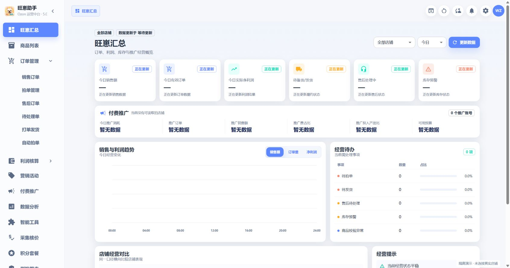

### 商品管理

按店铺、关键词和商品状态筛选商品，查看货号、类目、售价、库存、佣金费用、预估利润及重量。出售中、待销售、错误、待修改、违规和已下架商品集中展示，便于定位需要处理的商品。

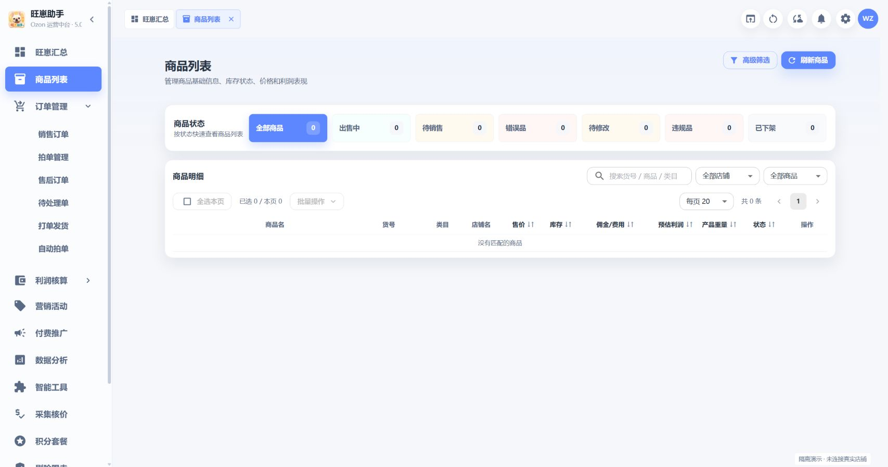

### 订单管理

按履约状态查找销售订单，查看商品、金额、佣金、付款时间和订单详情。分区还提供售后订单、待处理单、打单发货入口，用于跟进退款、异常及发货事项；批量操作依赖有效店铺配置和平台回执。

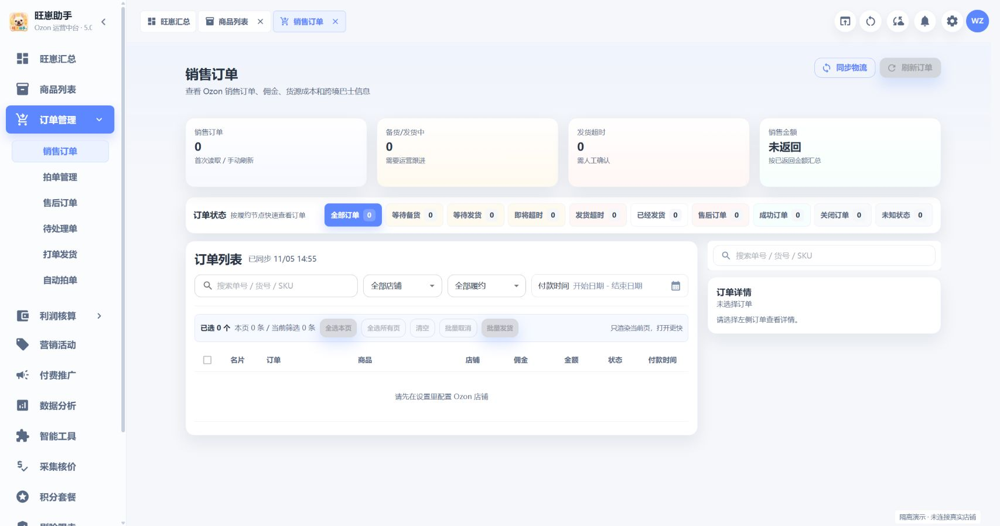

### 采购拍单

跟踪待拍单、待预报、待发货、已发货和采购售后等进度，关联货源、采购订单、国内物流与包裹信息。另有自动拍单入口，需配置自己的采购账号及相关服务后使用。

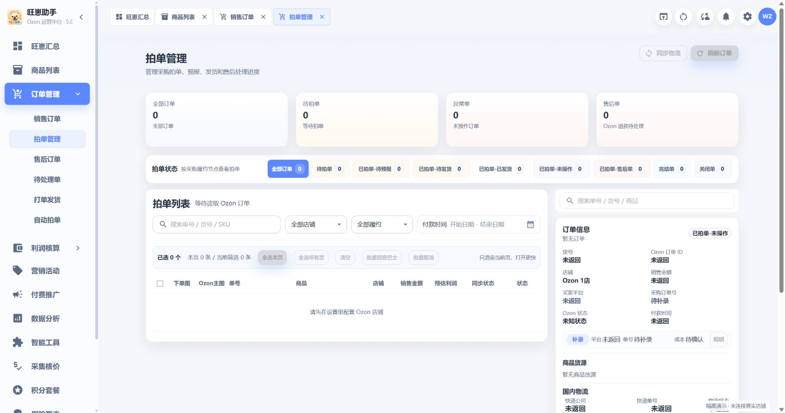

### 利润核算

按订单查看预估利润、实际利润及盈亏，结合销售额、货源成本、平台费用和物流信息核对收益。提供订单利润与利润报表入口；缺少成本或财务数据时会显示待确认，不应将其当作已结算利润。

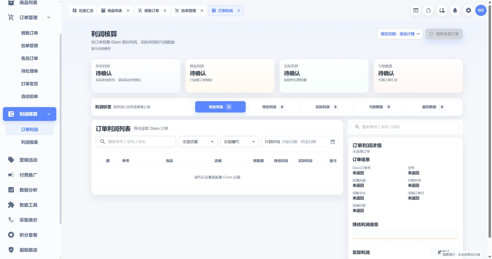

### 营销活动

读取店铺活动，查看已参加活动和已添加、可添加商品，准备活动折扣调整计划。页面提供异常商品提示、提交修改及再次读取复核入口，便于核对处理结果。

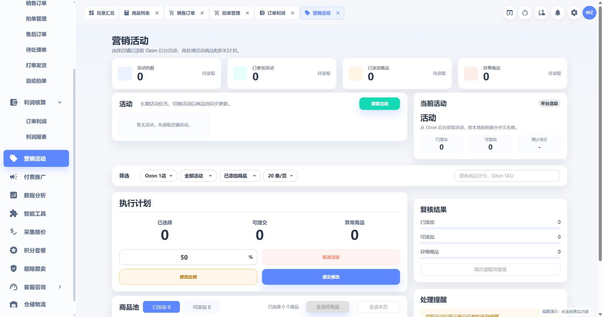

### 付费推广

用于读取店铺推广数据，配合数据分析中的广告分区和智能工具中的广告分析查看投放情况。需要配置 Ozon 推广接口；下图展示未配置时的提示，不包含实际广告数据。

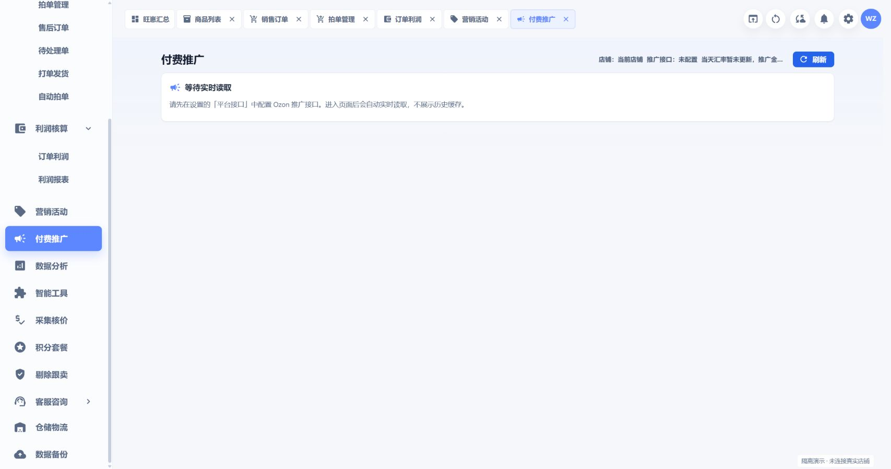

### 数据分析

按店铺和统计周期查看总览、销售、商品、流量、广告、利润、库存、售后、促销与市场分区，并提供流量同步、重新计算及经营分析入口。下图展示筛选器和分区导航；隔离环境没有经营快照，因此未展示分析图表。

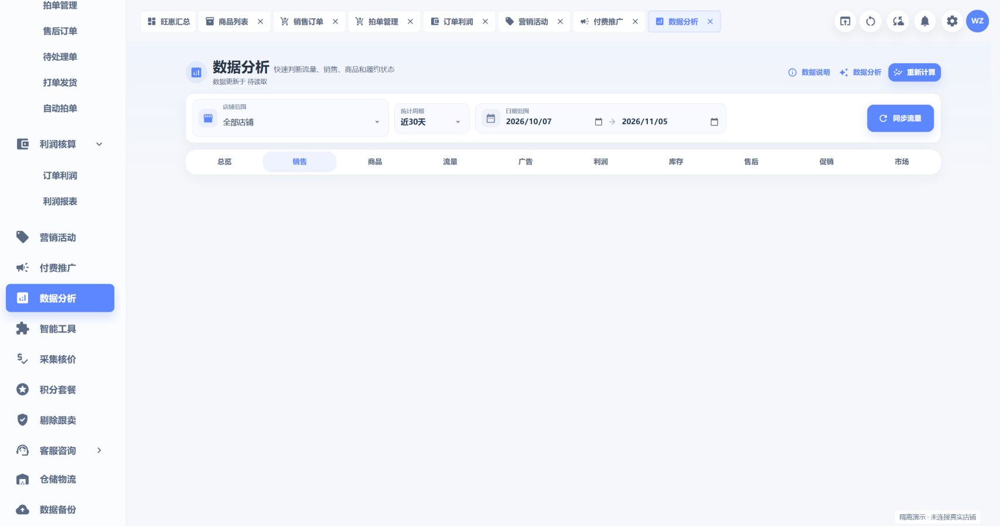

### 智能工具

按用途管理和运行 Skill，涵盖商品搜索、选品、广告分析、商品图方案、订单利润评估、经营报表及采购资料读取等工具。支持安装、编辑和分类管理；工具能否执行取决于适配状态、账号、模型和外部接口配置。

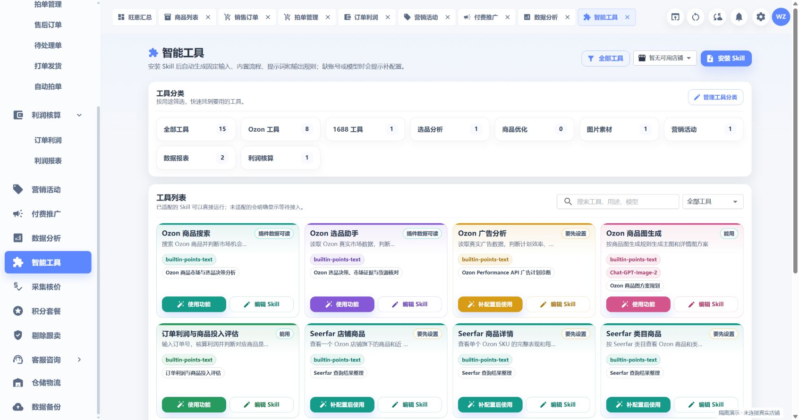

### 采集核价

通过内置浏览器或商品链接整理来源商品和图片资料，按 Ozon 竞品、1688、拼多多、淘宝、天猫等来源筛选本次采集列表，为货源对比和后续核价准备资料。实际采集依赖桌面浏览器和对应平台访问条件。

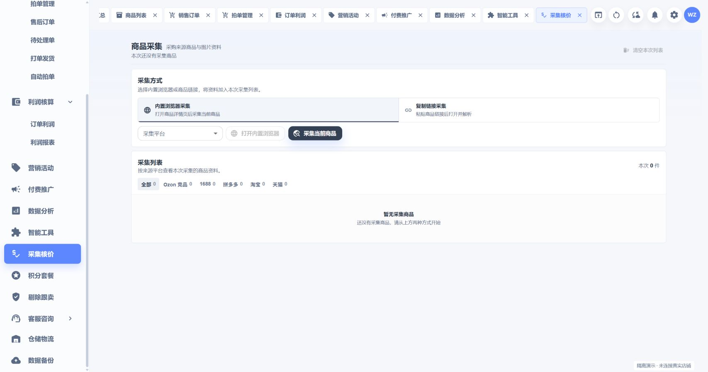

### 剔除跟卖

提供单货号处理、全店巡查、被跟卖列表和任务记录，查看发现跟卖、等待确认及需要重试的情况，并生成处理预览。需要独立 Ozon 前台巡查账号；最终处理结果以平台回执为准。

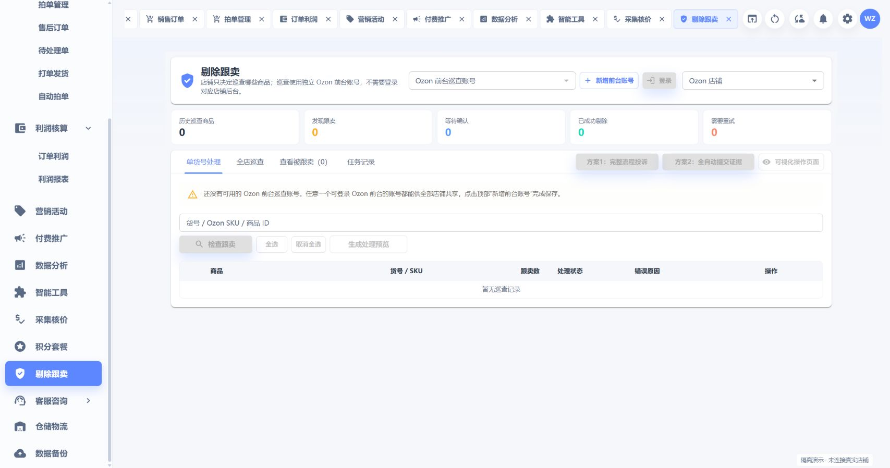

### 客服咨询

**在线客服**集中查看买家咨询、Ozon 通知与平台支持会话，可搜索、筛选未读消息，并通过快捷回复或附件处理沟通。

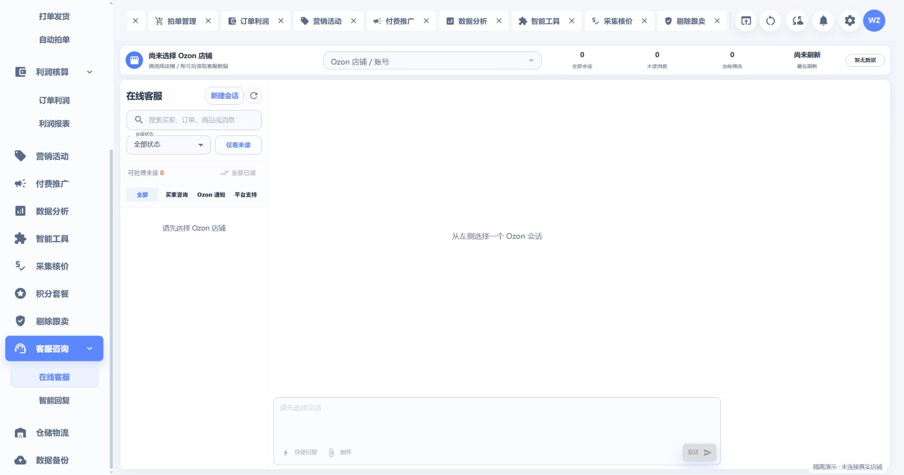

**智能回复**按清关资料提醒、催取货、发货通知和评价邀请等场景维护俄语模板，查看中文译文及消息预览，并配置生效店铺和发送规则。自动发送需要对应执行服务就绪；图中姓名、日期和单号是源码自带的模板示例。

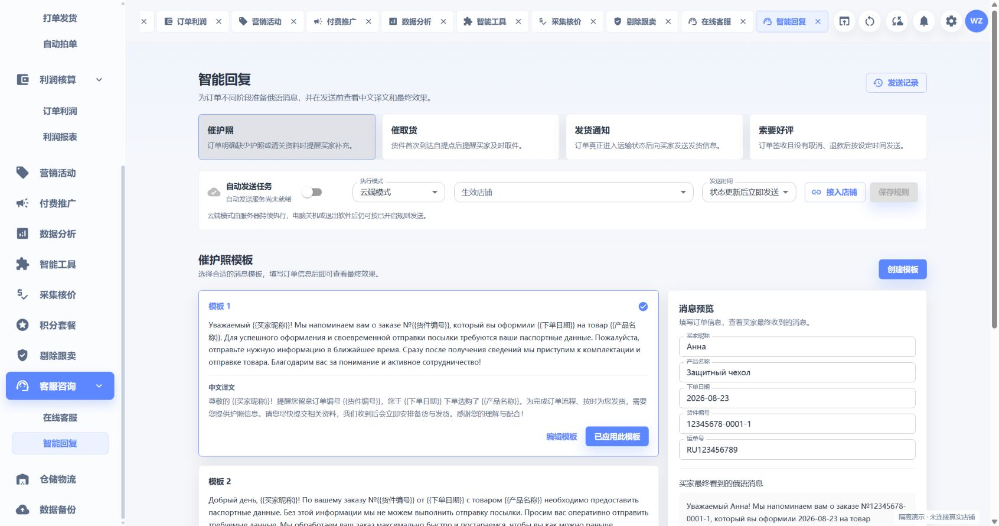

### 仓储物流

管理店铺仓库和配送方式，查看商品与仓库关联，并按重量、长宽高、货值及运输等级测算物流费用。提供多家物流的测算入口，实际费用仍需结合所用渠道及有效资费确认。

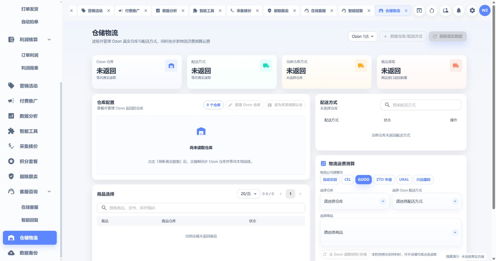

### 数据备份

按账号或店铺导出本地备份，在换机或重装时先预检、再确认恢复。支持历史订单 Excel/CSV 导入和模板下载，并查看备份与导入记录；历史资料不会自动回传 Ozon。

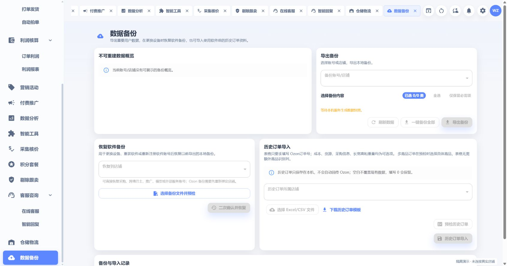

### 积分套餐

展示模型规格、积分用量估算、余额和后端配置的套餐信息。此页是源码保留的服务管理入口，**公开仓库不附带可用充值通道或官方模型额度**；截图中的单价与估算来自演示配置，不构成服务报价。第三方模型及图片接口费用由使用者自行承担。

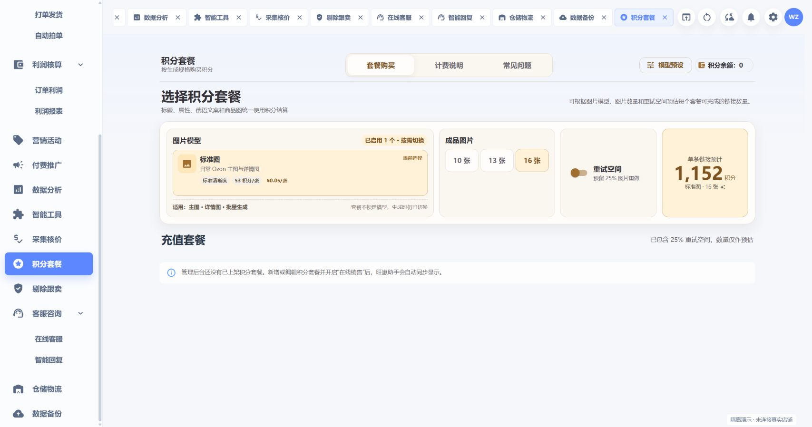

### 设置中心

统一管理 Ozon 店铺、跨境物流、采购账号、模型接口、微信助理、水印模板、费用口径和外部接口配置。支持连接测试与配置状态查看；公开截图中的店铺列表和凭据字段均为空。

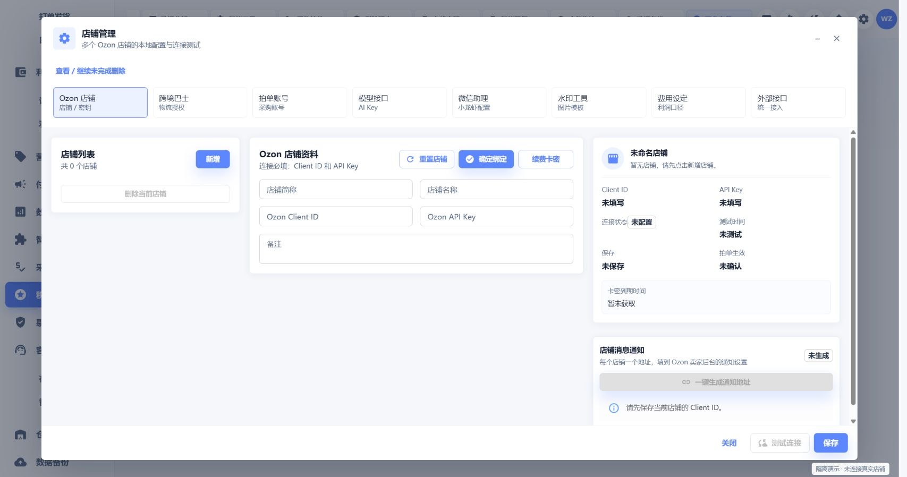

## 项目公告

2026-11-08：补齐管理后台、SDK、接入示例和部署工具。公开源码测试与真实业务证据验收已分为独立流程；四项证据检查完整保留，正式发布仍受门禁约束，见 [测试与验收说明](docs/TESTING.md)。

当前为实验性源码首发，仍有已知回归失败和未完成的产品验收，不提供稳定安装包或生产可用承诺。请先阅读 [验证状态与已知限制](docs/PUBLICATION_STATUS.md)。

## 交流群

欢迎加入 QQ 交流群，交流本地部署、使用经验和项目开发。

**QQ群号：645887185**。可在 QQ 中搜索群号，或扫描下方二维码加入。

<a href="docs/images/qq-community.png">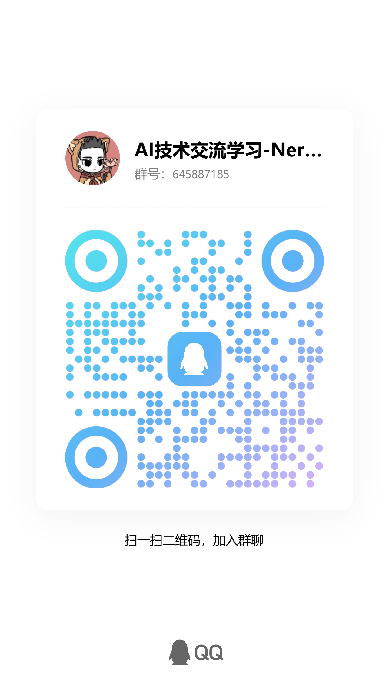</a>

点击图片可查看原图。

## 环境与部署

- Windows 10/11 x64，Node.js 24，Python 3.12，.NET 8 SDK（仅 .NET Runtime 不够）。
- 仓库所在目录名应为 `旺崽助手-新版本`，当前版本隔离检查依赖该名称。
- 每个部署生成自己的账号、密钥、TLS 证书和数据库，不连接作者的原发行系统。

完整步骤见 [本地部署](docs/SELF_HOSTING.md)。从源码克隆时可以指定目录名：

```powershell
git clone https://github.com/superbaiss/wangzai-assistant.git 旺崽助手-新版本
cd 旺崽助手-新版本
```

首次运行建议使用空 profile，先熟悉只读流程。初始化配置关闭真实平台写入和连续同步；只有在自己的部署中明确配置并理解对应操作后再启用。

## 本轮准备内容

- 从跟踪源码导出，不携带原 Git 历史、真实 profile、数据库、凭据、依赖目录或安装包。
- 发行配置、签名公钥包及本地业务配置改为单独准备；仓库仅提供示例。
- 移除私人知识库链接，部署及模型中转地址改为 `.invalid` 示例，店铺与订单标识改为样例。
- 保留本机回环地址、平台公共接口、协议域名和第三方许可证原文。
- 冻结账号归属账本及其校验器保留原文，其中历史通用路径是验证夹具，不含当前个人用户目录；不能为了替换路径改写冻结证据。
- 内部评审、历史安全网、文档截图及再分发许可未确认的来源材料不纳入本次副本。

## 校验

要求 Node.js 24 或更高版本，在根目录执行：

```powershell
node tools/audit-public-source.mjs --tracked
node --test tools/audit-public-source.test.mjs
node frontend/scripts/scan-secrets.mjs --all
```

新增检查不替代 Gitleaks、图片隐私复核、第三方许可审查或产品发布门禁。冻结清单的哈希未刷新，原有及脱敏新增的差异仍需复核。

## 服务与验证边界

- 示例配置不包含任何可用的官方发行凭据。`server/scripts/self_host.py init` 创建自己的本地配置、账号和签名密钥，拒绝覆盖已有安装。
- 授权、签名与产品发布校验完整保留；缺少有效配置时失败是预期行为，不能通过关闭校验来冒充部署成功。
- 图片服务默认地址不提供服务。可使用同一个明确配置的 HTTPS 图片接口，设置方式见部署文档；第三方 API、OSS 和模型服务的用量费用由使用者自行承担。
- 两个采购预报测试已改为自建 SQLite 夹具；外部 Skill 安装包测试已使用原创合成夹具。
- 图表已改用 Apache ECharts。第三方许可证、素材授权及二进制分发义务见 [THIRD_PARTY_NOTICES.md](THIRD_PARTY_NOTICES.md)。

正式安装、隔离集成、全量测试、真实环境验收均不能由本次脱敏检查代替。
